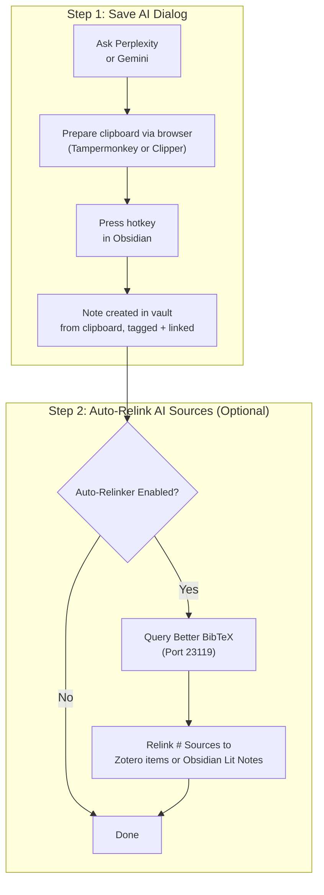
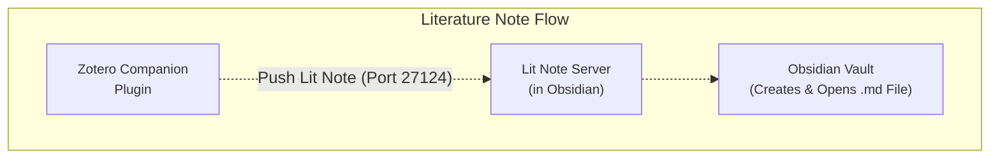

# Obsidian Perplexity Saver

[](https://github.com/notuntoward/obsidian-perplexity-saver/actions/workflows/build.yml)
[](https://github.com/notuntoward/obsidian-perplexity-saver/actions/workflows/codeql.yml)
[](https://github.com/notuntoward/obsidian-perplexity-saver/actions/workflows/scorecard.yml)
[](https://securityscorecards.dev/viewer/?uri=github.com/notuntoward/obsidian-perplexity-saver)

This plugin saves conversational threads from Perplexity.ai into your Obsidian vault, retaining proper Markdown formatting, deep-linking citations to footnotes, and generating clean metadata headers for fast search and archival.

It also supports rich integration with Zotero 7/8/9 to automatically link your Perplexity sources to your local Zotero library, and allows creating Zotero literature notes directly into Obsidian via a companion Zotero plugin.






---

# Zotero & Literature Note Integration

This plugin serves as the Obsidian backbone for a complete literature note and citation workflow with Zotero. It provides two main features: 
1. **Source Relinking**: Automatically matches and relinks `# Sources` in your Perplexity saves to your local Zotero items or existing literature notes.
2. **Local HTTP Server**: Runs a zero-configuration local server on port `27124` that allows Zotero to instantly push new literature notes directly into your vault.

### Prerequisites & Dependencies
- **Zotero 7/8/9** running locally.
- **[Zotero Obsidian Companion](https://github.com/notuntoward/zotero-obsidian-companion)**: The companion plugin installed in Zotero 7/8/9. (This provides the "Create Lit Note" command, among others, in Zotero).
- **Zotero Local API enabled**: Check `Zotero -> Settings -> Advanced -> Allow other applications on this computer to communicate with Zotero`.
- **Better BibTeX** (optional, highly recommended): Provides reliable citekeys.

### Commands

- **"Import AI dialog from clipboard"** - parses clipboard text into a new note with formatted callouts and sources.
- **"Sync AI dialog from clipboard"** - appends new turns to the active note.
- **"Sync linked AI dialog from clipboard"** - identical to the sync command, but runs on the dialog note linked at your current cursor position (e.g. inside `[[My Dialog]]`), allowing you to sync new turns without leaving your referencing note.
- **"Replace linked AI dialog from clipboard"** - completely replaces (overwrites) the AI dialog note linked at your current cursor position with the parsed dialog from your clipboard. Resets turn watermarks and regenerates all dialog turns, citations, and metadata without leaving your referencing note.
- **"Delete AI dialog turn"** - opens a fuzzy-searchable picker of dialog turns in the current note to select a turn to delete, then removes the turn heading, prompt callout, and AI response, automatically cleaning up any orphaned sources in `# Sources` that were only cited by that turn.
- **"Remove sources with no cite"** - scans the active note and removes any sources from the `# Sources` section that are not cited in the AI response of any dialog turn in the note.
- **"Remove sources with no dialog"** - scans the active note and removes any sources from `# Sources` whose referencing dialog turns have been deleted, or updates the ownership list if only some citing turns remain.
- **"Jump to turn response"** - opens a fuzzy-searchable popup of the current dialog's headings, instantly jumping your cursor to the start of the AI's response for the selected turn. The turn you are currently reading is marked with a subtle box.
- **"Relink sources with Zotero"** - manually relinks the current note's `# Sources` section. Shows a live progress notice and reports how many sources were matched (split into Zotero items vs. literature notes). If nothing new matches, the note is left untouched.
- **"Get literature note link"** - inserts a literature note link at your cursor in any note. Opens a fuzzy-searchable picker of your literature notes (scoped to the *Literature notes folder* setting, ranked with recently opened notes first), then a second picker for the link description built from the note's aliases or title. The inserted wikilink looks like `[[Smith 2020 - Topic|smith2020: Topic]] `, with the citekey's year-disambiguation suffix stripped and a bare citekey description used when the note has no aliases.
- **"Video: show or hide transcript"** - closes this note's visible transcript, or opens its stored transcript (the section under the *Transcript heading* setting) using *Default transcript panel location*, one row per stored timestamp. The command, viewer's captions button and C key share the same toggle, including an explicitly sidebar-placed transcript associated with a pop-out video. Each timestamp links to that moment in the video. The format selector offers **Original captions / lines**, **Original paragraphs** and **Readable paragraphs**; timing comparison modes appear when *Caption word timing* is enabled. **Original paragraphs** keeps the Media Extended-style cue-gap and roughly one-minute grouping, most faithfully with notes stored using *Every caption*. The panel follows when you open another note that has a transcript; a panel whose note already has a loaded player, in any window, stays with that player instead.
  - **Readable paragraphs**: groups complete punctuation-derived sentences into flowing prose. Confirmed English uses local vocabulary/topic transitions and modest discourse-cue adjustments. Paragraph lengths target about 120 words with a 160-word cap; global balancing helps avoid a tiny leftover tail. A single longer sentence is never split. This is a local formatting heuristic, not semantic understanding or an acoustic pause detector: sentence-start spacing and caption display durations are not used as silence. No extra downloads, Python, models or API calls; choosing this format does not rewrite the note. Every sentence retains its timestamp, playback highlighting, keyboard navigation, search and filtering. With *Caption word timing* enabled, matching saved timings are reused offline; otherwise caption anchors are used and starts inside a caption are marked **≈**. Switching formats preserves source position without seeking. Successful timing still initially selects **Word-timed sentences**; choose **Readable paragraphs** whenever preferred.
  - **Other or unknown languages**: use the same paragraph-length balancing without English vocabulary or discourse heuristics. Chinese/Japanese use non-whitespace grapheme counts instead, targeting about 300 characters with a 400-character cap; unknown-language text containing those scripts uses character lengths too, without claiming to identify its language. A warning toast explains the fallback and is not repeated on ordinary panel rerenders/reloads. Sentence segmentation uses the saved caption locale when available and maps sentences by character offsets, including unspaced text. When no sentence boundaries are observed across multiple cues and the text has no final sentence-ending punctuation, group whole caption cues instead; the header identifies them as captions. Text without punctuation cannot acquire reliable sentences automatically.
  - **Caption language metadata**: new downloads retain the actual selected track's language in a hidden `<!-- saver-transcript-language: fr -->` comment, including English regional variants. A translated track's `tlang` output language takes precedence over its source language; requesting English does not label a fallback French track English. Missing, invalid, undetermined or conflicting metadata uses the unknown-language fallback, not text-based guessing. Older notes are not modified automatically. If you know an older transcript is English, you can explicitly add `<!-- saver-transcript-language: en -->` under its transcript heading to enable English topic grouping. A fresh caption-timing check also stores the selected output language; offline cache reuse does not guess it. Language annotations do not invalidate existing compact timing fingerprints.
  - **Placement**: click the labeled **Layout** button beside the format selector in the transcript toolbar. Its menu contains only **Show pane tabs and navigation** and **Toggle transcript below / beside video**. The **Transcript: toggle below / beside video** command flips the current orientation too, including restored panes; from the sidebar it first moves below the video. Right-sidebar placement remains available through *Default transcript panel location* or an existing bound legacy sidebar shortcut, not the Layout menu. Moving preserves formatting, filtering preference and last-search recall; the viewer opens paused if needed. The choice applies to this note for the current plugin session, including closing/reopening its panel, without changing the saved default. Obsidian restores open panes normally; restarting Saver clears its per-note session choices.
  - **Pane chrome**: in a non-top, non-stacked tab group containing only the transcript, its redundant tab strip and native title/navigation header are hidden. The transcript remains a normal Obsidian pane with its split divider and workspace restoration. Tabs/header reappear when another tab joins the group; top-of-window controls and stacked tabs stay intact. For native tab dragging or pane menu access, enable **Show pane tabs and navigation** in the layout menu (for this pane's lifetime). The toolbar's **X** closes the transcript and returns focus to its associated viewer.
  - **Search**: the search row is hidden when idle. The magnifying-glass button, Ctrl/Cmd+F, **Video: search transcript**, row Escape or a directional search command reveals it. Accepting/cancelling hides it again. Leaving the transcript cancels without stealing focus and retains last-query recall. Clicking search controls or browsing filtered rows within the transcript keeps search open. By default, rows containing all words in any order are matched case-insensitively. *Transcript matching* can instead require a literal phrase. Enter / Shift+Enter (or the arrow buttons) go to the next / previous match in the default Obsidian-style mode; F3 / Shift+F3 work in either mode. **Tab or the checkmark button accepts the selected match without playing**: it clears the search, restores all transcript rows even with filtering enabled, and focuses that row so ↑/↓ browse the surrounding transcript. Ctrl/Cmd+Enter (or the play button) still plays the selected match. The filter button shows only matching rows while searching; the X button cancels.
  - **Keyboard behavior**: choose *Obsidian-style* (Enter next, Shift+Enter previous, Esc accepts) or *Emacs-style* (Enter accepts, Esc cancels), as in Incremental Search. Directional search commands first focus search when a transcript row or toolbar control has focus, then navigate matches on subsequent presses in the search box. In Emacs-style mode, accepting or cancelling remembers the panel's last non-empty query: the next search starts empty, and repeating a directional command before typing recalls that query and selects the next/previous matching row from where search started, wrapping at the ends. The repeat command's direction wins, and typed text is never replaced. Recall uses the same `commons/search` policy as Incremental Search's note/PDF search. They work in either mode and in pop-outs. Ctrl/Cmd+G cancels in either mode, restoring the pre-search row and scroll position; Tab accepts in either mode.
  - **Emacs search hotkey setup (Incremental Search is optional)**:
    - **Using Saver alone, or with Incremental Search disabled:** in **Settings → Hotkeys**, bind **Perplexity Saver: Transcript search: Forward Emacs** and **Transcript search: Reverse Emacs**, for example to Ctrl+S / Ctrl+R. Saver's commands are unassigned by default and work without any other plugin. They act only within the focused transcript panel, not in note editors or PDFs.
    - **Using the [Incremental Search plugin](https://github.com/notuntoward/obsidian-incremental-search):** bind its **Forward Emacs** and **Reverse Emacs** commands instead. Those same shortcuts search notes/PDFs and, when focus is in the transcript panel, start or navigate transcript search through the shared `commons` integration. **Leave Saver's own directional commands unassigned when reusing those keys.** Do not assign Ctrl+S / Ctrl+R (or any identical shortcut) to both plugins: that creates an Obsidian hotkey conflict. Separate, transcript-only shortcuts on Saver are optional if you want them.
    - **If you later disable or uninstall Incremental Search:** assign the desired keys to Saver's commands so transcript navigation remains available.
    - Emacs hints and arrow-button tooltips show Saver's assigned bindings first, otherwise Incremental Search's optional bindings, or **Unassigned** when neither has a binding. There are no hardcoded Ctrl+S/R handlers; use your actual assigned keys.
  - **Keyboard on rows**: clicking a line selects it. ↑/↓ or Ctrl+N/Ctrl+P move between lines (after Page Up/Down they start from the lines on screen), Home/End focus the first/last visible line without seeking or starting playback, Enter plays the video from the line, Shift+Enter moves the video there without starting it, Ctrl/Cmd+C copies a timestamp link such as `[1:23](https://www.youtube.com/watch?v=ID&t=83)` to paste into a note (when no text is selected), and Esc returns to the search box. If you move to rows without accepting the search, navigation skips filtered-out rows. The **?** button toggles keyboard help for the current search/browsing mode; hints take no space by default.
  - **Following playback**: the viewer's current playing or paused chunk is highlighted. Opening the transcript panel focuses and scrolls to that chunk immediately, even with *Follow playback in transcript* off; it does not seek or start playback, and returns to full-row browsing if a search was active. Clicking a timestamp link in a note also reveals the matching chunk immediately, even if the panel was recently scrolled or a transcript row still has keyboard focus. If no transcript panel is open, Saver opens the note's transcript and centers the clicked chunk without taking keyboard focus from the note, except when online with a visible video player, so a timestamp click never reopens a transcript pane you deliberately closed. Offline, or when no player is visible and none answers, the transcript is the fallback instead of a stalled player. With following on, later playback updates scroll the panel to keep the current chunk in view. Scrolling pauses for a few seconds after you scroll or click in the panel, and while a search is active.
  - **Transcript-only playback**: when no video player is visible in the panel's window, the transcript shows play/pause, previous/next transcript row, and insert-current-timestamp controls. They use the associated playback session without opening a player pane.
- **"Video: search transcript"** - puts the cursor in the transcript panel's search box (opening the active note's transcript first if no panel is open).
- **Legacy shortcuts**: the old show-transcript ID still runs the toggle, preserving its hotkey. Redundant **Transcript: move to ...** and viewer-specific transcript-toggle commands register only when they already have assigned hotkeys at plugin startup, with a **legacy shortcut** label. Unbound duplicates disappear; existing hotkey settings are not rewritten. Use the main toggle, orientation, **Video: choose workspace...** and **Video: cycle panes** commands for new bindings.
- **Video playback commands** remain available for hotkeys in **Settings → Hotkeys**: play or pause, faster / slower / normal speed, screenshots (drag an area or capture the whole picture), copy or insert a timestamp, and open in browser at the current time. **Video: back 10 seconds** and **Video: forward 10 seconds** shift playback without changing its paused/playing state. Playback and timestamp commands work while focus is in the associated note, viewer or transcript. With **Note + transcript**, playback, speed, timestamp copy/insertion and open-in-browser use background audio without opening or focusing a video pane. Transcript row playback and timestamp clicks use that same audio session, and transcript highlighting/following remains active. Screenshot commands require an open video pane and desktop Obsidian.
  - **Insert timestamp list item** pauses playback and inserts a timestamped list item at the note's tracked cursor, then focuses the note so you can type. Existing selected text is preserved. At the end of a list item, it creates a sibling immediately below with the same indentation and marker; an empty item is reused, and ordered lists advance their number. Within other non-empty text, the timestamp is placed on its own list block. **Settings → Video viewer → Timestamp list item style** chooses *Match current list* (the default), *Unordered list (-)*, *Ordered list (1.)*, or *Task list (- [ ])*. Ordered items start at `1.` on a blank line; every style keeps the cursor's indentation and placement.
  - **Insert screenshot** pauses playback, saves an image attachment first, then inserts a timestamped image list item at that same tracked note position. Use the region command to drag a snip, or the whole-picture command to capture immediately. Both preserve the current bullet hierarchy, with the image indented inside the new sibling item, and remain paused; if the note/editor closes during capture, Saver reports that the image was saved but could not be inserted. The original screenshot commands still save and copy the embed plus timestamp for manual pasting.
- **"Video: next transcript timestamp" / "Video: previous transcript timestamp"** seek to the next or previous transcript row without wrapping or changing play/pause state. Previous skips the currently playing row rather than restarting it. They use the panel's current captions/paragraphs mode, or stored caption lines when the panel is closed, and work from the associated note, viewer or transcript, including background audio. Existing command IDs and hotkeys are retained. Timestamps written elsewhere in the note remain timeline marks, not transcript navigation targets.
- **"Video: choose workspace..."** - from a literature note, its player or transcript, choose which panes to show. Also available as **Video workspace...** in the note's file / more-options menu. When only the note is visible, the first, preselected choice is your **Video workspace default** (initially **Note + video**): press Enter to open it. Alternatives are **Note + transcript** and **Note + video + transcript**. With media visible, all four layouts appear with the current layout first and **Note only** to close the associated media and return to the note.
  - **Video workspace default** under **YouTube transcripts** is the layout the picker opens when no media is visible (initially **Note + video**). Choosing a layout in the picker applies it for that session without changing the default; change the default only in Settings. Preferences and per-note/video playback positions are saved in plugin data; note-only and manual player closure preserve the position, and reopening starts paused there. A changed video URL starts at zero rather than using another video's saved position.
  - Reuse associated panes and existing playback whenever possible. A hidden media tab sharing the note's tab group is split out so the chosen panes can be visible together. New panes respect **Video viewer location**, **Default transcript panel location**, and the current session's transcript orientation. Transcript-only never opens a video pane, even with a below/beside placement default; audio starts when requested. Switching between audio and a visible player preserves the current position, speed and playing/paused state, without simultaneous playback. **Note only**, closing the transcript and unloading Saver stop background audio and remember its position; reopening after closure starts paused. A transcript whose note has a loaded player, in any window, remains associated with that player, and workspace transcripts stay on their note, rather than following unrelated note opens.
  - Applying a layout returns focus to the literature note for typing. Other notes' media are not closed or repurposed. Missing video/transcript content is reported before closing existing media; cancelling the picker changes nothing. Playback/caption, transcript-following and insertion preferences are unchanged.
- **"Video: cycle panes"** moves focus to the next visible, associated pane in note → video → transcript order, across tab groups and pop-outs. It wraps around; note + video cycles between those two; note + transcript cycles between those two; note alone stays in the note. Background tabs and collapsed sidebars are skipped, not reopened. Existing `cycle-note-video-transcript` hotkey bindings are preserved.

The 2px theme-accent focus indicator marks only the player, transcript, or their associated literature note, independently of playback highlighting. The note is eligible only while its player or transcript is visible, including in another window. Unrelated notes and notes with only hidden/background media tabs remain unmarked. **Video note focus indicator** defaults to on and can be disabled.

#### Everyday video note-taking

1. Open a literature note with a YouTube link and run **Video: choose workspace...**. Press Enter to open your default layout; choosing another layout applies it without changing that default.
2. Choose **Note + video** to watch, **Note + transcript** to listen while reading, or **Note + video + transcript** for both. In transcript-only mode, use **Video: play or pause** or press Enter on a transcript row to start audio; no video pane is added.
3. Use **Video: cycle panes** to move between the panes you chose. It never opens a missing pane. The thin focus line identifies the active pane only within the associated video note-taking session.
4. Choose **Note only** when finished. Media closes and playback stops, but your default layout and playback position are retained for next time. Reopening starts paused; switching layouts within an ongoing session retains the playing/paused state.

The default layout is shared across notes; playback positions are stored separately per note and video. Speed is retained during a live layout switch, not saved as a per-note preference.

#### Video and transcript on separate windows or monitors

Obsidian panes can live in separate windows, and those windows can be moved to different monitors. Saver keeps a note's player and transcript in one session even when they are in different windows.

1. Set **Settings → Video viewer → Video viewer location** to **New window**. The player opens in a pop-out window; drag that window to the monitor you want.
2. Drag the transcript tab to the window or monitor you want. With a pop-out player, **Default transcript panel location → Right sidebar** opens the transcript beside the player in that pop-out; drag it to the main window (or another monitor) to keep it separate.
3. Open the note normally. Opening a different note does not move a transcript whose note already has a loaded player, in any window.
4. Use **Video: choose workspace...** from the note, its player or its transcript to add or close panes. **Note only** closes the associated media and remembers the position.
5. Clicking a timestamp link, pressing Enter on a transcript row, or using the transcript toolbar drives the note's player in whichever window it lives. It does not open a second player or start duplicate background audio.

For a three-monitor setup, leave the note in the main window and put the video on one monitor and the transcript on another. The transcript-only transport controls stay available when the player is in a different window, so you can control playback from the transcript's monitor. If you move the transcript into the same window as the player, those redundant controls hide.

**Video: cycle panes** includes panes across windows, and the focus indicator shows the active pane in a pop-out. Closing the player leaves the transcript as a standalone panel; reopening the note's player reattaches it. Closing the transcript with **Note only** stops playback and remembers the position.

#### Suggested hotkeys for the Main vault

These are suggestions, not plugin defaults; assign them in **Settings → Hotkeys**. The right column records the current Main-vault assignments so existing muscle memory can be retained. The candidate shortcuts were checked against that vault's current `hotkeys.json`.

| Priority | Action | Suggested shortcut | Main vault now |
|---|---|---|---|
| Highest | Play/pause | `Ctrl+Shift+Space` | `Ctrl+ContextMenu` |
| High | Cycle note → video → transcript | `Alt+V` | `Alt+V` |
| High | Insert timestamp list item | `Alt+Shift+T` | Unassigned |
| High | Insert screenshot snip | `Alt+Shift+S` | Unassigned |
| Medium | Copy timestamp | `Ctrl+Alt+T` | Same |
| Lower | Insert whole-frame screenshot | `Ctrl+Alt+Shift+S` | Unassigned |

`Alt+P`, `Alt+T`, and `Alt+S` already have other assignments in the Main vault, so these suggestions avoid those collisions. Unmodified `Alt+Left/Right` continue to navigate Obsidian history there.

### Native YouTube caption timing

All transcript downloads use **JSON3**, fetched directly by the plugin. The same
caption data supplies text, punctuation, caption times and available native word
offsets. There are no XML/SRT/VTT downloads, Python helpers, audio downloads,
WhisperX, yt-dlp, FFmpeg or model installations. Existing local environments are
not used or removed automatically.

The previous implementations are preserved on GitHub:
[WhisperX sentence alignment](https://github.com/notuntoward/obsidian-perplexity-saver/tree/archive/whisperx-sentence-alignment)
and [Jev sentence alignment](https://github.com/notuntoward/obsidian-perplexity-saver/tree/archive/jev-sentence-alignment).

**New notes:** the default **Every caption** format stores native word offsets
alongside the caption text automatically, without a second fetch or transcript.
The optional legacy **5-caption blocks** format still stores only block starts;
choose per-caption storage to retain native offsets and exact caption bounds.
Caption, sentence and readable-paragraph views are derived locally from the
stored transcript. JSON3 does not repair missing or incorrect punctuation.

Enable **Settings -> YouTube transcripts -> Caption word timing** to use saved
word offsets in sentence and paragraph views. Existing enabled/disabled preferences
are retained; the obsolete Python path setting is removed. No helper setup is
needed. Older notes without native timings still work with caption anchors:

1. Click **Time words**, or run **Transcript: time sentences from YouTube captions**.
2. Confirm **Check captions and save timings** to fetch JSON3. No note text is
   uploaded and there is no inference or API charge.
3. If wording or caption bounds differ, explicitly choose **Cancel** or
   **Replace transcript**. Replacement uses the fetched captions, their output
   language and native timings. Other sections and properties survive; errors,
   cancellation or concurrent body edits prevent applying new results.
4. Success selects **Word-timed sentences** without seeking or starting playback.
   **Compare**, search, filtering, keyboard controls and readable paragraphs remain
   available. Cancellation prevents saving, although an in-flight Obsidian HTTP
   request may finish. Existing timing/cancel command IDs retain their hotkeys.

**Timing and uncertainty.** The first word of a caption uses its original start.
A JSON3 segment offset times only the first word in that segment, not every word
inside a multiword segment. Missing offsets stay missing: sentence starts without
a usable native offset are marked **approximately (`≈`)**. Estimates use a known
word in the sentence or a preceding timing, never earlier than the current caption
anchor. Unspaced sentences retain their own caption anchors; unsupported starts
inside a whitespace timing token remain approximate. Missing internal word offsets
do not make a known sentence start approximate. Reversed or out-of-bound offsets
are rejected, while native starts tied at the next caption boundary are preserved.
Native timestamps are YouTube's timings, not verified acoustic boundaries.

**Compact offline storage.** Existing timestamp-link titles hold relative
millisecond offsets; `?` means a missing word start:

```markdown
[0:12](https://youtu.be/abcdefghijk?t=12 "12-14; w=0,?,900,?") We left. We stayed.
```

One `<!-- saver-word-timing:1 SOURCE_SHA256 -->` comment records a source
fingerprint. The caption language has its own hidden comment. No large timing
Properties or second transcript are created. Editing text, cue times or links
invalidates saved timings; unrelated note edits and language annotations do not.

**Compatibility:** existing untimed captions, legacy blocks, compact timings and
matching version-2 `whisperx_transcript` caches remain readable offline, including
previously accepted acoustic tuples. No new acoustic timings are produced.
**Compact saved timings** migrates an old property offline: save and verify the
body copy before removing only that property. Failed cleanup retains both copies
for retry; unrelated properties, including old Jev data, are untouched. No bulk
note migration or automatic transcript replacement occurs.

YouTube can reject a request or supply no usable captions; this is reported rather
than falling back to audio or another transcript format. Playback still requires
network access. These changes do not establish a fix for the separately reported
Properties freeze.

### YouTube video viewer

The picture area stays 16:9 instead of stretching to fill a tall pane; controls sit directly below it. Whole-picture screenshots capture this area, not unused pane space. Letterboxing or black backgrounds inherent to the video remain intact; non-16:9 videos may still have bars inside the YouTube player.

Clicking a YouTube link that has a time (`&t=83`, `?t=1m23s`, `#t=83`), whether one you typed, one in the stored transcript, or one in the transcript panel, opens the video at that moment in the viewer and starts playback. This works in reading view and live preview. Ctrl/Cmd-click does the opposite of the *Timestamp link click* setting (opens the browser instead of the viewer, or the other way round). One viewer is reused. Opening the viewer from **Video: choose workspace...**, opening it alongside a transcript, or restoring it when Obsidian starts does not start playback; press play (or Space) when ready. Seeking with the viewer's controls preserves paused/playing state. Playing from a transcript search match starts playback; accepting a search match does not. If no transcript panel is open, the click also opens the note's transcript and centers the matching chunk, except when online with a visible video player. Offline (or when no player is visible and none answers), that transcript is the fallback.

- **Timestamp and screenshot toolbar actions**: in **Settings → Video viewer → Toolbar timestamp and screenshot action**, choose **Insert into note** (the default, including existing installations without an explicit choice) or **Copy to clipboard**. This affects only clicking the player's link and camera icons; explicitly named copy and insert commands retain their behavior. Labels reflect the current setting immediately, without reopening the viewer. Right-click either icon or use its adjacent alternatives button for both destinations.
  - **Timestamp icon**: click to insert a timestamped list item into the associated literature note, or copy it when Copy is selected. Right-click or use the adjacent arrow for **Insert timestamp into note** and **Copy timestamp**.
  - **Camera icon**: click to select an area; **Shift-click** captures the whole picture immediately using the selected destination. Shift changes the capture area, not copy versus insert. Right-click or use the adjacent arrow for **Insert selected area into note...**, **Copy selected area...**, **Insert whole picture into note**, and **Copy whole picture**; these explicitly choose both area and destination, regardless of the setting or Shift.
  - **Insertion** requires the associated literature note open in editing view (Source mode or Live Preview), with the cursor where you want the addition. It pauses playback, preserves selected text and bullet hierarchy, inserts at the tracked cursor, then returns focus to that note. Screenshot insertions remain paused. Insertion leaves the clipboard unchanged. If the target is unavailable, Saver explains what is needed rather than silently copying instead.
- **Copy timestamp**: the toolbar's copy action and **Video: copy current timestamp** command pause playback at the current position and copy it as plain-text Markdown, without moving focus. In **Settings → Video viewer → Copy current timestamp format**, choose **Timestamp link only** (the default, `[1:23](https://www.youtube.com/watch?v=ID&t=83)`) or **List item**, which copies `- [1:23](https://www.youtube.com/watch?v=ID&t=83): ` including a trailing space. Paste a list item into an editable note to leave the cursor after `: `, outside the link, ready to type a plain-text description. This setting does not change direct insertions, transcript-row copies or screenshot copies.

#### Keyboard timestamps and optional Steady Links integration

- **Without Steady Links:** put the editor cursor on a timestamp link and invoke Obsidian's **Follow link under cursor** command, normally **Alt+Enter** on Windows/Linux or **Option+Enter** on macOS. Its assigned shortcut can be changed in Settings → Hotkeys. Saver routes that native command to the built-in video viewer at the timestamp and starts playback when *Timestamp link click* is set to *Open in the video viewer*. Plain Enter still inserts a newline; Saver does not take it over.
- **With [Steady Links](https://github.com/notuntoward/obsidian-steady-links):** its existing plain-Enter behavior in Live Preview also opens timestamp links in Saver's viewer. Keep *Keep links steady* enabled and place an unselected cursor inside the link. Its existing boundaries, selection, suggestion and IME rules are unchanged. At the link's outer edge, Enter still inserts a newline. Modified-Enter commands retain their native behavior; the native *Follow link under cursor* command is the one Saver intercepts.
- **Optional handshake:** Steady Links offers a cancelable, bubbling `commons:link-activation` event from the owning editor's `contentDOM`. Saver listens in each window, reads the link at that editor's cursor, and claims only supported YouTube URLs with an explicit timestamp. If Saver is missing/disabled, the URL is not a timestamp, or the setting chooses the browser, Steady Links falls back to Obsidian's normal link following. Neither plugin imports from or requires the other.
- Saver also uses this same handshake for native keyboard activation without Steady Links. Native availability checks never start playback. The native command adapter is restored when Saver unloads, and receivers are removed on window close/plugin unload. Ordinary wikilinks, other websites, and video links without timestamps are not claimed. The native editor token check prevents URLs in code or non-link text from being treated as links. Mouse Ctrl/Cmd-click retains its opposite-action behavior.

- **Controls**: The viewer toolbar provides back/forward 10 s, play/pause, current time, playback speed, zoom, timestamp copy/insert, open in browser, screenshot copy/insert, previous/next transcript row, and show/hide transcript. Use the commands listed above for supported hotkeys; the toolbar action setting does not change those commands.
- **Video pane header**: the redundant native Video navigation row is hidden; the top tab strip remains available for dragging, closing and window controls. When native window buttons overlay that strip, it retains at least Obsidian's header height so shorter-tab snippets cannot let the close button cover the video's corner. Other tab groups and fullscreen remain compact. Keyboard focus is marked by a non-interactive 2px accent at the pane's top edge without taking extra space.
- **Keyboard**: click the picture (or Tab into the viewer) to give it keyboard focus. Space/K play-pause, J/L ±10 s, ←/→ ±5 s, Page Up/Page Down ±1 minute, Home/End start/end, `[`/`]` previous/next transcript timestamp, `<`/`>` slower/faster, `+`/`-` zoom, `0` reset zoom, C show/hide transcript. Tab moves through the buttons (Enter or Space presses the focused one; the speed button opens its menu, which arrow keys navigate) and the timeline, which is a slider (arrows move ±5 s).
- **Open in browser**: the external-link button pauses the viewer and opens the video in your web browser at the current time.
- **Speed**: the gauge button opens a menu of speeds (0.25×-2×); the mouse wheel over it, or `<`/`>`, steps the speed. When not at normal speed the button is highlighted and shows the speed (e.g. "1.5×").
- **Transcript button**: highlighted while a transcript panel is visible; click it again to close the panel. If opening the transcript had expanded the collapsed right sidebar, closing it collapses the sidebar again. Below/beside placements work in pop-out windows too. The sidebar default opens beside a pop-out viewer; an explicit sidebar move uses the main window's sidebar.
- **On-picture captions**: **Settings → Video viewer → Show YouTube captions** defaults to off, including existing installations without an explicit choice, so screenshots do not inherit YouTube's caption preference. Turn it on to display the video's available closed captions. Changes apply to open viewers without seeking, restarting playback or changing the transcript panel. Off is reapplied when YouTube reports playback starting, with bounded retries over the next three seconds for late-loading captions; explicit setting saves also reapply the request. This uses YouTube's embedded-player caption module commands (verified in Obsidian, but not a documented on/off API); availability depends on YouTube and the video's caption tracks. Captions burned into the video itself cannot be removed. This does not hide YouTube's play button/title/other paused-player overlays.
- **Laptop layout**: choose below-video placement, then drag Obsidian's horizontal divider upward to give the transcript more height. The whole 16:9 picture shrinks to fit the available viewer height, retaining its controls without cropping; zoomed pan scales with the resized picture. In tall panes it still uses the natural width-based 16:9 size. Viewer padding overrides Obsidian's large native bottom inset: 4px vertical padding and gaps, with a 12px-high seek-bar target, leave more height for the picture without shrinking control buttons. Transcript title, count, formatting and icon controls share a compact toolbar; search and keyboard help consume space only when used.
- **Timeline**: a thin line along the bottom; click or drag to seek. Subtle marks show the timestamps in your own notes for this video (transcript links are not marked); dragging snaps to a nearby mark. The marks update as you edit the note.
- **Zoom**: mouse wheel zooms around the pointer (up to 6×), drag pans while zoomed, double-click resets. A click on the picture plays or pauses.
- **Screenshot** (desktop only): the camera button pauses the video and lets you drag a rectangle to snip, like the Windows Snipping Tool; click without dragging (or press Enter) for the whole picture, Esc to cancel. Shift-click the camera captures the whole picture immediately. The PNG (of exactly what is shown, including zoom) is saved to your attachment folder. In **Insert into note** mode, Saver inserts a timestamped image list item at the associated note's tracked cursor, returns focus to the note and leaves playback paused. In **Copy to clipboard** mode, it copies an image embed plus timestamp link for manual pasting; area selection resumes previously playing video afterwards, including on cancellation. The existing whole-picture copy action captures immediately without changing playback state. Right-click lets you choose either destination for either capture area. The file is named `<note name> <date> @<video time>.png`, e.g. `Feynman 1964 - The Character of Physical 2026-11-06 @1m05s.png`; long note names are shortened at a word boundary to about 40 characters.

---

# Settings Configuration

### AI Import Settings
- **AI save folder** (default: `ai-searches`): Folder name where notes are created (relative to your currently active note).
- **AI generated tag** (default: `ai-generated`): Tag inserted into the frontmatter.
- **Collapse blank lines** (default: on): Collapses consecutive blank lines into a single blank line to make the note structure clean and dense while keeping one blank line between paragraphs and headings.
- **Collapse prompt callouts** (default: on): When on, user prompts start collapsed (`> [!Prompt]-`). When off, they start expanded (`> [!Prompt]+`).

### Prompt Heading Formatting
- **Heading max characters** (default: `100`): Maximum length for the summary heading, including a possible ellipsis.
- **Prompt heading method** (default: `Lead sentence`): Choice between `Lead sentence` (first sentence that fits, fast) and `TF-IDF ranked sentence` (ranks sentences by term salience with a lead-position prior).
- **Heading lead bias** (default: `0.20`): TF-IDF only. Determines how much to favor sentences closer to the start of the prompt (0 disables it, reasonable range 0.05-0.35).

### Source Link Title Fetching
- **Auto-fetch source titles** (default: on): Fetches webpage titles for sources that don't already have one, producing clean markdown links instead of bare URLs.
- **Source title max characters** (default: `100`): Maximum length of a fetched source link title, including a possible ellipsis.

### Zotero & Literature Note Relinking
- **Auto-relink sources** (default: off): Automatically runs Zotero relinking at the end of commands that generate or modify turns (**Import AI dialog from clipboard**, **Sync AI dialog from clipboard**, and **Replace linked AI dialog from clipboard**).
- **Better BibTeX HTTP port** (default: `23119`): Local HTTP port used to fetch citation metadata from the Zotero Better BibTeX plugin.
- **Literature notes folder** (default: `lit/lit_notes`): Vault folder where literature notes reside (and where new notes sent from the Zotero companion plugin are saved). Leave blank to search anywhere in the vault.
- **Minimum title match score** (default: `95`): Minimum fuzzy similarity score (0-100) required to match an AI source to a Zotero item.
- **Zotero library cache**: Button to clear the in-memory cached Zotero library so the next relink fetches fresh from Zotero.

*(Note: The local HTTP port `27124` that listens for literature notes from Zotero is completely zero-configuration and runs automatically in the background).*

### Literature Note Formatting

- **Validate author name format** (default: off): When enabled, warns before creating a literature note if any author or creator name with **multiple words** is not in `Last, First` format.

  **Why this matters**: Obsidian Bases sorts and filters the `authors` property by the first element of each list entry. For last-name search to work (e.g. finding "Einstein" without knowing "Albert"), names must be stored as `Einstein, Albert` rather than `Albert Einstein`.

  **Mononym exemption**: Single-word names — such as *Aristotle*, *Prince*, or *Voltaire* — are always accepted without a comma. The check only flags multi-word names without commas, which is the ambiguous case where it is unclear which part is the last name.

  **BibTeX Name Parser & Auto-Correction**: When an ambiguous name is detected, the built-in dependency-free BibTeX name parser attempts to recognize the name structure (handling First/Last, Jr/Sr suffixes like `Smith, John Jr`, and Dutch/German `von` particles like `van Beethoven, Ludwig`). When a reliable correction can be identified, the warning dialog presents an **"Auto-correct & create"** option alongside **"Create anyway"**, **"Edit in Zotero"**, and **"Cancel"**.

- **Author name format style** (default: `Last, First`): Configures the author property output style when creating literature notes:
  - `Last, First` (default): Standard catalog order (`Einstein, Albert`).
  - `BibTeX`: Full canonical BibTeX syntax (`von Last, Jr, First`).
  - `First Last`: Natural reading order (`Albert Einstein`).
  - `Last only`: Surname/particle only (`van Beethoven`).
  - `Initials`: First initials with surname (`J. Smith`, `J.-P. Sartre`).

- **Drop 'von' particle** (default: off): When using `Last, First` style, optionally omits lowercase surname particles such as `von`, `van`, or `de la` (producing `Beethoven, Ludwig` instead of `van Beethoven, Ludwig`).

### YouTube Transcripts
- **Collapse transcript on open** (default: on): Each time a note opens, folds only its transcript heading in Source mode, Live Preview, or Reading view, including pop-outs. This also runs when a restored background tab is first visited after startup, and after Zotero finishes creating/opening a note and placing its cursor. Click the heading arrow to expand it for normal editing or copying; Saver does not continually re-fold it. Uses the configured heading with the legacy `Transcript` fallback, without changing the note's Markdown. Search or navigation into the transcript can subsequently unfold it. Enable Obsidian's **Settings -> Editor -> Fold heading** to use the heading arrow. Turning this option off stops automatic folding on future openings; it does not unfold sections already collapsed.
- **Download YouTube transcripts** (default: on): When enabled, automatically downloads the timestamped transcript and inserts it two blank lines below the note body under the transcript heading when creating literature notes from YouTube video references (e.g. `youtube.com` or `youtu.be` URLs). The editor cursor is automatically positioned on the blank line directly above the transcript heading.
- **Transcript heading** (default: `Transcript`): Name of the H1 heading the downloaded transcript is stored under (leading `#` characters are ignored). The transcript side panel looks for this heading (at any level, case-insensitive) and falls back to `Transcript` for notes created before the name was changed.
- **Transcript detail** (default: every caption): How the downloaded transcript is written. *Every caption* stores one line per caption, e.g. `[1:23](https://youtu.be/ID?t=83 "83.45–86.12") and that's why`: the visible link is a short `m:ss` time, and the link title (shown on hover) keeps the caption's exact start and end time in seconds, so nothing is lost and paragraph formatting in the transcript panel still works. Markdown characters in caption text are backslash-escaped so they display as plain text. *5-caption blocks* stores one shorter line per 5 captions with only a whole-second start time, e.g. `[01:23](https://youtu.be/…&t=83) …`. The transcript panel reads both formats, and the older `[01:23.450 → 01:26.120](…)` caption lines too.
### Transcript Panel
- **Search keyboard behavior** (default: Obsidian-style): Same acceptance/cancellation modes as Incremental Search. Tab always accepts without playing and restores the full transcript.
- **Transcript matching** (default: all words): Match every query word in any order, or select *Literal phrase* for exact phrase matching. Both are case-insensitive and search displayed transcript text, not timestamp URLs.
- **Highlight all matches** (default: always): *Always*, *On demand* (toggle the highlighter button), or *Off* (current match only). Unlike Incremental Search, Ctrl/Cmd+Enter remains the playback shortcut. Highlighting does not change matching or filtering.
- **Default transcript panel location** (default: right sidebar): Initial placement: sidebar, below or beside the video viewer (opening the viewer, paused, if needed). Use **Layout → Toggle transcript below / beside video** or **Transcript: toggle below / beside video** for a per-note session override without changing this preference. The Layout menu also offers **Show pane tabs and navigation**; explicit move commands remain only as already-bound legacy shortcuts.
- **Follow playback in transcript** (default: on): While the video viewer plays, scroll the transcript panel to keep the current line in view (the line is highlighted either way).

### Video Viewer
- **Show YouTube captions** (default: off): Explicitly request closed captions off or on over the picture, independently of YouTube's stored preference and Saver's transcript panel. Applies to existing viewers and new/restored viewers. Does not remove burned-in text or paused-player overlays.
- **Timestamp link click** (default: open in the video viewer): What a plain click on a YouTube link with a time does, in notes and in the transcript panel. Ctrl/Cmd-click does the other (open in the browser).
- **Toolbar timestamp and screenshot action** (default: insert into note): Clicking the player's link or camera icon inserts into the associated literature note, or copies to the clipboard if you select that option. Right-click offers both. Shift-click the camera takes the whole picture using the selected destination. Explicit copy/insert commands are unchanged. Insert requires the associated note open in editing view.
- **Timestamp list item style** (default: match current list): The list form inserted by **Video: insert timestamp list item** and the toolbar's insert action. *Match current list* reuses the current marker and advances ordered numbering; *Unordered list (-)*, *Ordered list (1.)*, and *Task list (- [ ])* start that form. An ordered item on a blank line starts at `1.`. Indentation and placement follow the cursor, and empty list items are reused.
- **Copy current timestamp format** (default: timestamp link only): **Video: copy current timestamp** and the toolbar's copy action produce `[m:ss](URL)`. Choose *List item* to copy `- <timestamp link>: `, ready for a description after pasting. This setting does not affect direct insertions, transcript-row copies or screenshot copies.
- **Video viewer location** (default: split next to the note): Where a new video viewer opens; *New window* opens it in a pop-out window. An open viewer for the note is always reused, in any window.

---

# Data Formats

### Expected Clipboard Format
The Obsidian plugin parses clipboard content generated by the export scripts. It expects standard Markdown containing:

1. **Metadata Header**: The script must prepend a line starting with `[Perplexity](URL)` at the very beginning of the text to identify the source and trigger the Perplexity parser.
2. **Conversation Turns**: For stock Perplexity exports, prompt/response pairs should be separated by horizontal rules (`---` or `***`). The user's prompt is typically formatted as a Markdown heading (e.g. `# Prompt Text`) or separated by a blank line.
3. **Citations (Optional)**: A trailing section beginning with `# Citations:` or `**Sources:**` containing numbered markdown links (e.g., `[1] https://example.com`).

*(Note: The plugin also supports an annotated format containing `<!-- PPLX-TURN n -->` comments for more precise boundary alignment).*

### Final Saved Note Format
When the plugin imports a dialog, it constructs a highly structured Obsidian note formatted for readability and Zotero integration:

- **Source Metadata**: A clean link to the original conversation at the top of the note.
- **`# Dialog` Section**: The main conversation history.
  - **Prompts** are rendered as Obsidian callouts (e.g. `> [!Prompt]+`) to distinguish them visually from AI text. They are prefixed with a summary heading containing a block reference anchor (e.g. `### Summary of prompt ^t1`).
  - **AI Responses** follow immediately as standard Markdown, with their inline citation markers (e.g. `[1]`) rewritten to point cleanly to the aggregated sources at the bottom.
- **`# Sources` Section**: An aggregated list of all citations used in the conversation, formatted as Obsidian footnotes/links. These can be automatically relinked to Zotero literature notes using the plugin's commands.
- **Footnote navigation**: Ctrl/Cmd-click a footnote marker in the editor to jump to its definition in the same pane, rather than following the source URL. The destination source line is highlighted for two seconds with an accent-tinted background and an accent edge, making it easy to identify among adjacent sources even when the theme's normal text highlight is transparent. Another jump restarts the highlight; editing clears it. In Live Preview, plain clicks also jump when the citation is outside the line being edited. Plain clicks on the editing line and in Source mode remain editing actions; Reading view keeps Obsidian's native behavior. Relinking a definition to a literature note or Zotero does not change this navigation.

---

# Installation & Setup

### A. Obsidian Plugin Setup
*(See "Building from Source" below if you want to install from source).*

1. Download the latest release from the Releases page.
2. Unzip and copy the folder into your vault under `<your vault>/.obsidian/plugins/`.
3. In Obsidian, go to **Settings -> Community plugins**, disable Restricted mode if needed, refresh the plugin list, and enable **Perplexity Saver**.
4. Go to **Settings -> Hotkeys**, search "Import AI dialog from clipboard", and assign a hotkey (e.g., `Ctrl+Shift+V`).

### B. Perplexity UserScript Setup (Tampermonkey)
To set up the automated boundary-aligning "Direct" exporter:
1. Install the [Tampermonkey](https://www.tampermonkey.net/) browser extension.
2. Open Tampermonkey's dashboard, click "Create a new script," and replace the default code with the contents of [`browser-userscript/perplexity-obsidian-exporter-direct.user.js`](./browser-userscript/perplexity-obsidian-exporter-direct.user.js) from this repository. Save it.
   - If the older **via Complexity** exporter is installed, disable it so only one exporter handles the page. The Direct exporter does not require the Complexity extension.
3. In your browser's extension settings (e.g. `chrome://extensions` -> **Tampermonkey** -> **Details**):
   - Confirm Tampermonkey is enabled.
   - Set **Site access** to **On all sites** (or explicitly permit `https://www.perplexity.ai`).
   - Turn on **Allow access to file URLs** and/or **Allow user scripts** depending on your browser.
4. Reload your Perplexity tab. Click the floating **Copy for Obsidian** icon beside the composer. It opens Perplexity's native menu and selects **Export as Markdown** for you. That menu is deliberately hidden while the automated export drives it (version 8.19 and later), so the popup does not flash on screen. You can also select **Export as Markdown** manually; both routes use the same capture pipeline.

Version 8.12 brings back the circular Obsidian icon, purple hover feedback and
light/dark glass styling from the older Complexity script, without its extension
dependency. The button follows the composer when the page resizes, moves above
it on narrow screens, and is hidden outside conversation pages. Compact,
theme-aware status messages retain progress/success/error indicators.
Repeated clicks are blocked while an export is pending. Missing menus and
failed exports restore the button for retry; a 60-second timeout prevents a
stuck busy state. Navigating away cancels the pending capture before clipboard
writing. Native menu selection and download interception still work separately.
Use version 8.13 or later: it fixes a missing download-blob registry in 8.12
that caused the "Could not process export" error and prevented busy-state cleanup.

On `/session/` pages, version 8.11 and later restore full prompts that Perplexity omits
from its native Markdown, including long collapsed prompts and quoted context.
It reads the session's structured conversation data through a bounded React
ancestor lookup, so earlier prompts need not be visible and **Read more** need
not be clicked. Responses and source URL footnotes come from the native export.
Before copying, it checks response text (ignoring formatting/citation syntax),
cited source numbers, every source URL and the conversation's turn order.
It preserves native response formatting; it does not add source-card snippets
or titles that the native export omits.
Version 8.14 also repairs named citation labels that native export incorrectly
wraps in multiline `$$` math delimiters. It restores the original bracketed
label only when confirmed by the structured answer and followed by a native
footnote reference, preventing broken tables and swallowed footnotes while
preserving actual math and code.
Version 8.15 removes redundant square brackets around confirmed named citation
labels immediately beside footnotes (for example, `[Publisher].[^1_1]` becomes
`Publisher.[^1_1]`). It retains the label text, footnote IDs and source definitions,
and leaves ordinary links and code alone. This cleanup applies to verified
`/session/` exports; the plugin's navigation fix also works with existing notes,
without reimporting them.

If a session is still generating, Perplexity changes its internal data shape,
or the export cannot be matched completely, the script reports an error, leaves
the clipboard unchanged and saves the unmodified native file instead. That file
may still lack prompts; it is not a verified complete conversation. Version 8.16
and later log a single `[PPLX Session Diag]` console entry first, naming the
failed check (source count or order, answer text, citation IDs) with short
head/tail samples of the attempted chunks. Source URLs are compared after
decoding percent-escapes, because Perplexity's native Markdown can contain a
raw space where its structured data uses `%20` (for example
`84 0013_April25.pdf`); version 8.18 writes that encoded form into the note so
the footnote links stay clickable. Existing `/search/` exports retain their
previous processing.

### C. Gemini Web Clipper Setup
1. Install the official **Obsidian Web Clipper** from your browser's extension store.
2. Open the clipper, click the gear icon to open **Settings**, and set the destination/action to **Clipboard**.

---

# Building from Source

This project uses standard Node.js tooling.

```bash
# 1. Clone the repository
git clone https://github.com/notuntoward/obsidian-perplexity-saver.git
cd obsidian-perplexity-saver

# 2. Install dependencies (requires Node.js 18+)
npm install

# 3. Build the production files
npm run build
```

Once built, you need to manually copy the required distribution files into your Obsidian vault:
1. Create a folder in your vault: `<your_vault>/.obsidian/plugins/perplexity-saver/`
2. Copy the following three files into that new folder:
   - `main.js` (generated by the build)
   - `styles.css` (if it exists)
   - `manifest.json`
3. Restart Obsidian (or reload plugins) and enable it in the Community Plugins tab.

---

# Troubleshooting & Edge Cases

### Multi-Paragraph Prompts and Boundary Detection
Perplexity's markdown exporter fundamentally lacks boundaries between user prompts and AI responses (they are just separated by blank lines). To reliably parse threads, the UserScript must identify the true prompt text by reading Perplexity's internal React state tree or falling back to a DOM sibling scan.

If you edit a multi-paragraph prompt, or if Perplexity breaks the prompt into multiple content blocks in their internal state, the script handles this gracefully by scanning the entire conversation tree for the **longest matching message** that shares the same heading, and unpacking any array-based text blocks. This guarantees that no paragraphs are accidentally orphaned into the AI response.

In the event of a catastrophic scraper failure (where both React state and DOM extraction fail), the script falls back to purely guessing boundaries from the raw Markdown. To ensure that **pages-long prompts** are never accidentally swallowed by the AI response, this text-guesser is strictly bounded: it will only walk backwards over paragraphs that definitively start with known AI intro phrases (e.g., "Here is", "Certainly"), and it will instantly stop if it hits a paragraph ending in a question mark.

---

# Credits

- Thanks to [Tampermonkey](https://www.tampermonkey.net/) chrome extension
- Zotero connections inspired by [Zotero Bridge](https://github.com/vanakat/zotero-bridge) by vanakat
- YouTube transcript downloading based on and inspired by [obsidian-yt-transcript](https://github.com/lstrzepek/obsidian-yt-transcript) (YTranscript) by Łukasz Strzępek

# Deprecated Workflows & Legacy Interfaces

*The following sections outline older browser extensions and Tampermonkey configurations which are no longer recommended but remain supported for backward compatibility.*

### Complexity Chrome Extension & Older Tampermonkey Script
Previously, exporting multi-turn dialogs from Perplexity required installing the "Complexity" Chrome companion plugin along with an older script. While still functional, this has been deprecated in favor of the **Direct & Robust UserScript** (`perplexity-obsidian-exporter-direct.user.js`), which has zero dependencies, does not require the "Complexity" extension, and operates directly inside Perplexity's native export menu.

If you are still using Complexity:
1. Install the [Complexity](https://github.com/pnd280/complexity) Chrome extension.
2. In Tampermonkey, use the [`browser-userscript/perplexity-obsidian-exporter.user.js`](./browser-userscript/perplexity-obsidian-exporter.user.js) script instead.
3. This adds a floating circular "📝 Copy for Obsidian" button near the bottom right of Perplexity, which triggers the Complexity popup and copies the formatted thread.
