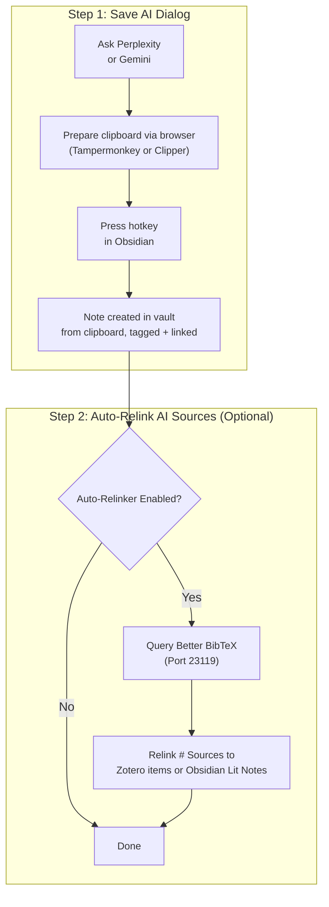
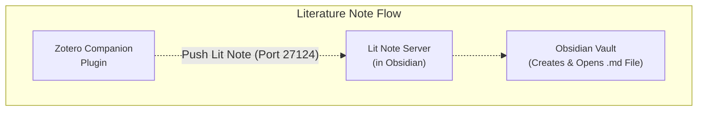

# Obsidian Perplexity Saver

[](https://github.com/notuntoward/obsidian-perplexity-saver/actions/workflows/build.yml)
[](https://github.com/notuntoward/obsidian-perplexity-saver/actions/workflows/codeql.yml)
[](https://github.com/notuntoward/obsidian-perplexity-saver/actions/workflows/scorecard.yml)
[](https://securityscorecards.dev/viewer/?uri=github.com/notuntoward/obsidian-perplexity-saver)

This plugin saves conversational threads from Perplexity.ai into your Obsidian vault, retaining proper Markdown formatting, deep-linking citations to footnotes, and generating clean metadata headers for fast search and archival.

It also supports integration with Zotero to automatically link your Perplexity sources to your local Zotero library, and allows creating Zotero literature notes directly into Obsidian via a companion Zotero plugin.

The literature-note decision and author-format dialogs use the shared
`commons/modal` appearance, with readable unshaded text and responsive actions.





---

# Zotero & Literature Note Integration

This plugin serves as the Obsidian backbone for a complete literature note and citation workflow with Zotero. It provides two main features: 
1. **Source Relinking**: Automatically matches and relinks `# Sources` in your Perplexity saves to your local Zotero items or existing literature notes.
2. **Local HTTP Server**: Runs a zero-configuration local server on port `27124` that allows Zotero to instantly push new literature notes directly into your vault.

Saving AI conversations does not require Zotero or its companion. Source relinking
uses Zotero's local API and does not require the companion. Creating, opening,
updating and checking literature notes from Zotero requires both Zotero and the
Zotero Obsidian Companion, with Perplexity Saver enabled in the target vault.
The companion's settings are in Zotero, not in Perplexity Saver's settings.
Its optional literature-note column uses library and item identities, not tags.
To pause automatic consistency checks, open **Zotero → Settings → Obsidian**
and enable **Pause automatic Zotero and Obsidian checks**. This option is not a
Saver setting. A check already in progress finishes; while paused, differences
may go unnoticed until you run **Check all literature notes against Zotero again**
in Obsidian or resume automatic checks. Interrupted updates are still recovered,
and existing reviews remain available.

The **Zotero reviews** status entry appears for an active check, a check error,
or pending reviews; it disappears when there is nothing to show, including while
automatic checks are paused. Its absence does not prove that a check ran or that
Zotero is connected. To diagnose a missing review, check the pause setting in
Zotero and run **Check all literature notes against Zotero again** in Obsidian.
Keep Zotero and the updated companion running: if the check does not start within
20 seconds, Saver warns that the companion has not responded. A completed check
reports whether anything needs review.

### Zotero and Obsidian setup

1. Install and enable Perplexity Saver in the Obsidian vault, and install the [Zotero Obsidian Companion](https://github.com/notuntoward/zotero-obsidian-companion#installation) in Zotero 10. Use current versions of both plugins so unresolved file attachments can be reported correctly.
2. In Obsidian, open **Settings → Perplexity Saver → Zotero & Literature Note Relinking** and set **Literature notes folder** to the vault-relative folder for your notes (default `lit/lit_notes`). Keep this vault open with Perplexity Saver enabled. Its local listener uses `127.0.0.1:27124`; no companion port setting is needed. The companion can try to launch Obsidian if it is closed.
3. In Zotero, ensure each item has a **Citation Key**. [Better BibTeX](https://retorque.re/zotero-better-bibtex/installation/) is recommended for generating keys but is optional; you can use or enter keys in Zotero's native field. Without active BBT, the companion shows a one-time recommendation and its **Regen Citation Key** command is unavailable; its settings show BBT's status.
4. For optional **Relink sources with Zotero** functionality, enable **Settings → Advanced → Allow other applications on this computer to communicate with Zotero** in Zotero. This local API setting is separate from the literature-note listener. Leave Saver's **Better BibTeX HTTP Port** at `23119` unless Zotero uses another port.

For companion commands and Zotero-side settings, see the [companion README](https://github.com/notuntoward/zotero-obsidian-companion#commands--usage).

### Attachment files and filenames

- **Location:** To include a supported file attachment link in a literature note, the actual Zotero attachment file must be inside the open vault and indexed by Obsidian. Saver links that exact file, not another file with the same name. The supported extensions are `.pdf`, `.html`, `.docx`, `.pptx`, `.epub`, and `.txt`; URL-only attachments are not file links.
- **Stored or linked:** Zotero's stored files normally live in its data directory, often outside the vault. Linked files can point to files inside the vault. Routine note creation does not move attachments. During automatic reconciliation of an eligible existing note, a nonempty matching note attachment is kept and Zotero is linked to it, even when its contents differ from the original Zotero file or that file is missing. Other Zotero files are copied to unused names in the validated base directory and linked in the note. If the note link is missing or empty, a unique corresponding usable Zotero file replaces it. Paths of preserved originals are recorded in the note and can be listed with **List preserved Zotero attachment files**; missing originals are not listed as preserved. Stored attachments are replaced by linked attachments; group-library attachments are not eligible. Automatic reconciliation stops with a persistent warning when the base directory is invalid. Other attachment errors are logged in Obsidian's developer console rather than shown as pop-ups. Do not move Zotero's whole data directory into a synced vault to solve attachment linking; see [Zotero's data-directory safety guidance](https://www.zotero.org/support/preferences/advanced#data_directory_location).
- **Optional ZotMoov:** To move imported files into the vault and link them in Zotero, configure ZotMoov's **Directory to Move Files To** to a folder inside the vault, choose **move** under **File Behavior**, and enable **Automatically Move/Copy Files When Added** if desired. ZotMoov's **copy** mode is a separate backup, not the file Zotero tracks. Check allowed extensions, and back up your library before moving existing files. Zotero group libraries do not support linked files. See [ZotMoov's settings](https://github.com/wileyyugioh/zotmoov/blob/master/docs/SETTINGS_INFO.md) for details.
- **Linked attachment base directory:** In Zotero **Settings → Advanced → Files and Folders**, this optional setting makes linked paths relative to a chosen folder; it does not apply to stored files, move files, or choose ZotMoov's destination. It may be unset for absolute paths. If you use relative paths, set it on each computer to the local folder containing those linked files, and ensure the resolved attachments are inside that computer's open vault. The companion checks this directory against the open vault at startup and when the setting changes, and retries if Obsidian is unavailable. A base directory outside the vault does not prove that every linked file is outside it. See [Zotero's base-directory guidance](https://www.zotero.org/support/preferences/advanced#linked_attachment_base_directory).
- **Optional renaming:** In Zotero's General settings, enable automatic file renaming and, for linked files, **Rename linked files**. To use the citation key as the filename, set the filename format to `{{ citationKey }}`. Zotero applies its own eligibility and file-type rules; it does not necessarily rename every supplementary attachment. See [Zotero's file-renaming documentation](https://www.zotero.org/support/file_renaming).

Saver's settings show the open vault's path and the resolved literature notes folder. The notes folder is vault-relative and does not have to match Zotero's linked attachment base directory. A blank notes-folder setting searches the whole vault and creates new notes at its root.

When creating or overwriting a note, including after choosing Create for a missing note, Saver checks file attachment paths and marks supported attachments unavailable if needed. Warnings explain whether Zotero did not resolve a path, the path is outside the vault, the file is missing, or Obsidian has not indexed it. Attachment warnings do not prevent note creation. Automatic reconciliation requires a validated base directory inside the vault; if it is invalid, it leaves attachments unchanged and shows a persistent warning. Invalid notes-folder paths and write failures are reported as errors with guidance to check Saver's setting and permissions.

To check the setup, select a Zotero item with a citation key and an accessible supported attachment, then choose **Obsidian → Create Lit Note**. Confirm that the note opens in the intended vault and that its attachment link opens the actual file. If it does not, check the warning and the attachment's location before changing settings.

### Updating existing literature notes

With both plugins running and automatic checks enabled, the companion checks citation keys and attachment links once at the start of the session. Automatic checks never open a decision dialog: when the initial check finishes, a notice directs you to **Zotero reviews** in Obsidian's status bar. The button shows the number of items needing review; all review types appear together, and the count drops as reviews are completed. The companion does not scan for new differences again until the apps restart. Restarting only Zotero is enough: its new check replaces the previous one, keeps interrupted or unacknowledged reviews, and rediscovers the others. Hover over the button for batch progress. The status entry disappears when all reviews are complete. Zotero must be running to prepare reviews using current data. Pending reviews are held in memory and rediscovered by the next initial check; while paused, run a manual check to rediscover them after restarting Obsidian. When citation keys differ, Obsidian shows the key in each app and lets you choose which to keep. Before offering the Obsidian citation key, the companion checks accessible Zotero libraries for matching keys and identifies any other items found; it checks again before changing Zotero. If the check cannot be completed, the update stops with an error. Choosing the Obsidian citation key changes Zotero first; the companion verifies the saved key and checks attachment paths again before continuing. It waits for matching item snapshots, but this is a best-effort settling check, not a signal that other plugins have finished. If Obsidian is closed at startup, the initial check waits until it is available. The first automatic reconciliation of an older note requires confirmation in Obsidian; unchanged legacy notes can instead be associated with **Update Lit Note**. Notes without a Zotero item key appear in **Zotero reviews** with their paths. Open the note, add a verified item key, then run **Check all literature notes against Zotero again**; the plugins never guess the association.

The review window stays open as items finish and offers bulk actions for interrupted attachment repairs, missing library URIs, compatible yes-or-no note updates, and eligible attachment moves. It reminds you to back up your vault and Zotero data before making changes. For other interrupted updates, **Review one by one** advances through the group without reopening the list; closing a decision stops the sequence. Expand a group to review its items individually, or search for a title or note. Bulk actions are hidden while searching so they cannot unexpectedly affect items outside the search. It shows the count and proposed actions, and asks for confirmation before starting. A URI-only batch does not change attachment links or files; a read-only recheck clears resolved reviews and leaves other differences for review. The status-bar count is the number of notes still needing review, not the number of missing URIs. Each note and Zotero item is checked again before writing. Changed or ambiguous items remain in the review list instead of being guessed. A bulk note update may include moving identical files to Trash when the group explicitly says so; the same reference and content checks used for individual updates still apply. Bulk reviews require the updated companion to be installed and running.

For attachment moves, **Continue to backup** only opens the backup confirmation; **Move attachments now** starts the batch after confirmation.
If Zotero cannot check whether other attachments reference the originals, linked files can still be copied into the vault while leaving the originals untouched. Stored-file replacement stops if references cannot be checked or another Zotero attachment points into its storage folder. Check all references before manually deleting an original. If the planned destination already contains a different file, a copy that would otherwise replace it gets an unused filename.
New vault filenames use Zotero's current attachment-renaming format. If Zotero cannot supply a valid name, the move remains for individual review. Changed files stop the move; if a later step fails, check both apps before retrying because the operation may be partially complete.
For unconfirmed moves, choose **Copy and repair all** or expand the group to repair an item individually. Zotero is linked to the vault copy; the original is preserved, and existing different files are not overwritten. Saver checks that the copies match the originals and that both apps link to them before clearing that item's interrupted-operation record. If the repair cannot be completed, it remains for review. Check references before manually deleting an original.

The **List preserved Zotero attachment files** command creates a snapshot note of originals recorded by these repairs, with links to the associated notes, Zotero items, original folders and vault copies. Stored attachments are archived, including snapshot resources, under `obsidian-companion-attachment-archive` in Zotero's data directory, outside Zotero's `storage` folder. The note records the archive and former storage paths. Zotero's original attachment is placed in its Trash; its stored file may continue to count against Zotero storage quota until the Trash is emptied and Zotero syncs. The archive uses local disk space but is outside Zotero's synced storage. When a stored main file is missing, its remaining resources are verified against a separate archive and recorded as **Resource archive (main file was missing)**, not as a preserved main file. Replacement still stops if other Zotero attachments reference those resources or reference checks fail. The list is not an inventory of all backups, and paths may have changed. Check both apps and other references before deleting a file yourself. Earlier repairs may have left two Zotero attachments; the report flags these for inspection rather than deleting either attachment.

During automatic reconciliation, an absolute attachment link in the info header is converted to a vault-relative link when the existing indexed file is inside the vault. Files already linked in the vault do not require an attachment review. Stored HTML snapshots with accompanying files are copied together into a new vault subfolder so their resources remain available.

In reconciliation dialogs, click the Zotero item to open it in Zotero. Clicking the Obsidian note closes the dialog and cancels the current review so the note can be edited; after editing, select it again in **Zotero reviews** or choose **Update Lit Note** in Zotero to retry. Your Zotero changes from the preceding step are not undone. Copy buttons are available for both citekeys and the Zotero item key; the item key can also be searched in Zotero.

If multiple notes claim the same Zotero item, selecting its review opens all matching notes side by side instead of trying to choose a note automatically: the first as a new tab in the current tab group, the others as tabs in one other group (an existing group in the window, or a new one only when there is none). Nothing is changed while you compare. A notice offers a **Keep** button for each note, with the one holding the most of your own text (then the most links) marked as suggested; each compared pane also has a **Keep this note** header button. Choosing a note merges the others into it:

1. A dialog lists, for each other note, the text you wrote that the kept note lacks (Saver's generated info, citation and Zotero Note sections and the template placeholder are left out). All of it is selected; clear the boxes for text you do not need. When a note belongs to a different Zotero item that no remaining note uses, choose whether to keep that item or move it to the Zotero trash.
2. When the merge would change the kept note's properties, **Continue** opens a review of those properties as they will be after the merge (see step 3); otherwise **Merge** finishes at once. The merge copies the selected text into the kept note, in place of the placeholder or before its Zotero Note section, under a line reading "Merged from X on DATE. Tidy this text, then remove this line." Repeating a merge does not copy text twice.
3. Properties are merged automatically, then shown for approval in the same property editor as Property Porter's **Edit property clipboard**. The other notes' titles and aliases are proposed as aliases of the kept note (their note names and citation keys are not, because links to them are redirected); tags (matched regardless of case) and lists are combined; properties the kept note lacks are added; and property names that differ only in case are treated as one. Each row is marked **New**, **Values added**, **Changed** (showing the kept note's old value) or **Unchanged** (collapsed), and names the note each new value came from. Where the notes have different single values, choose one. Remove any value or property you do not want, or press **R** on a row to keep the note's current value; **Keep current values** does this for every row and then becomes **Use proposed values**. Properties Saver fills from Zotero, such as the citation key, Zotero item key, authors and DOI, are shown read-only and never merged, and property links to the merged notes are left out rather than becoming links to the kept note itself. **Merge** writes exactly what you approved; **Cancel** or Esc cancels the whole merge, so nothing is copied, redirected or moved to trash. If you edit a property of the kept note while the review is open, your edit wins (a list still gains the approved values). Links and embeds to the merged notes in other notes and in properties are redirected to the kept note, keeping headings, block references and display text.
4. Each merged note is moved to trash, following your trash settings, only when all of its links were redirected and it did not change since the dialog opened; otherwise it is kept and the notice says why, and running the merge again is safe.
5. The kept note opens at the merged text, the comparison panes close, Zotero rechecks the item, and a notice waits while you tidy. Click it to compare the next duplicate set.

You can still fix duplicates by hand instead: keep `zotero_item_key` on the intended note and remove it from the others, or delete the extra notes. As soon as only one note matches, Saver adds the item's `zotero_library_uri` to that note if it was missing, so the fix does not reappear as a missing-library review, asks Zotero to recheck the item automatically, and shows a notice; click the notice to compare the next duplicate set without returning to **Zotero reviews**. Later comparisons reuse the same panes. If Zotero shows the explanation dialog instead, **Open notes side by side** does the same, and each note link opens in its own tab.

**Merge another note into this note** applies the same merge to any two notes: it asks for the note to merge into the active note. **Compare the next set of duplicate literature notes** resumes the duplicate review, and **Check all literature notes against Zotero again** asks Zotero to repeat its startup check without restarting either app. Both plugins must be updated for the recheck and for moving Zotero items to the trash; if Zotero does not start the check within 20 seconds, Saver says so.

If Zotero cannot confirm that an update finished, the plugins first compare the current item and note. When their identifiers and attachment links already match, the interrupted review is cleared automatically. Interrupted automatic attachment work is rechecked on restart, and completed moves are recorded before the remaining work is replanned. Other interrupted updates may remain in **Zotero reviews**. Zotero must be running to recover or review them. Keep both plugins updated.

The `zotero_library_uri` note property records which Zotero library contains the item, so items with the same key in different libraries are not confused. Older notes may not have it. Saver asks you to confirm the association before adding it; you do not need to enter it manually.

**Obsidian → Update Lit Note** in Zotero previews metadata and attachment changes before applying them. Collection membership is included in the preview; the first update with collection data asks you to review adopting the current Zotero membership, and later updates ask again if `zotero_collections` differs from the last accepted value. Applying adopts Zotero's current list (an empty list keeps the property as `[]`) and stores that baseline; canceling during the batch cancels it before any notes are written. It preserves personal properties such as tags, read status, linked status and creation date, and retains existing aliases while removing duplicates. Changes to aliases and filenames can affect links. Before a rename, Saver checks Obsidian's indexed backlinks; when any are found, it explains that it cannot determine whether **Automatically update internal links** is enabled. External or unindexed links may exist even when none are found. Review the preview and back up your vault.
Automatic collection reconciliation runs at startup for managed notes whose current value still matches their baseline. Newly created notes receive a baseline automatically; existing notes that already match Zotero are adopted without a review. Managed notes whose values agree with Zotero also refresh a stale baseline without rewriting the note or asking for another review; notes whose collection management was stopped remain unmanaged. Genuine differences stay unchanged and appear together in **Zotero reviews**, where one batch choice applies Zotero's values, keeps Obsidian's values and stops managing, or defers. Deferred differences remain held until resolved. Missing collection data from an older companion preserves the existing property.

If a repaired note exactly matches its baseline after the shared list normalization, Saver migrates that baseline before reconciling new Zotero memberships. This needs no repeat repair or approval; actual note edits, stopped management and unresolved interruptions remain protected.

Zotero tags and collection names are written to `zotero_tags` and `zotero_collections` as YAML lists, lowercased with spaces and underscores replaced by hyphens, matching Obsidian tag style (`Joe Biden` becomes `joe-biden`). The retired `obsLitNote` indicator is never written. Zotero tags never change the Obsidian `tags` property.

#### One-time repair of older literature-note properties

Older notes may have stringified lists (`"['a', 'b']"`), underscore-separated values, an old `ZoteroTags` property, the `obsLitNote` indicator, a missing `tags` property, or old `status`/`dateread` properties. A one-time repair script fixes these through Obsidian's frontmatter API. It adds an empty `tags` after `category` when missing; renames `ZoteroTags` to `zotero_tags`; adds either Zotero list property when missing; rewrites `zotero_tags` and `zotero_collections` as hyphenated lists without `obsLitNote`; and keeps both properties present as empty lists when they have no values. It replaces `status` and `dateread` with `read`, `in_progress` and `linked` after `tags` and before `aliases`. `read` is set when `dateread` had a value and `linked` when another note links to it. Existing personal values are kept, and repaired notes are left unchanged when it runs again. When applied, it also renormalizes stored collection baselines after backing up the plugin's `data.json`.

The repair resolves `data.json` from Saver's registered installation directory, which need not match its plugin ID. Missing settings or invalid baselines stop the repair before any notes are changed.

1. Back up the vault and disable Perplexity Saver (applying refuses to run while it is enabled).
2. Run `npm run bundle:repair` to build `build/repair-lit-notes.js`.
3. In Obsidian's developer console (Ctrl+Shift+I), load it: `(0, eval)(require("fs").readFileSync("<repo>/build/repair-lit-notes.js", "utf8"))`.
4. Dry run and review the counts and examples: `await litNoteRepair.runLitNoteRepair(app)`.
5. Apply: `await litNoteRepair.runLitNoteRepair(app, { apply: true })`. Re-enable Perplexity Saver afterward.


Matching attachment links do not require internal markers or a review. During automatic reconciliation, if the note's attachment link is missing or points to an empty file and exactly one unmatched, non-empty Zotero attachment of that type is available, Saver replaces the broken header link with a link to that file. A link such as `x.html` is treated as broken even if Obsidian created a stray `x.html.md` note when it was clicked. Saver offers to remove such notes: when Obsidian creates one, and at startup if any exist, a message explains how the note was created; click it to see the notes and the notes linking to them, then choose **Move to trash** or **Keep**. Only notes named like an attachment (for example `paper.pdf.md`) that contain nothing except date properties are offered, and a note that gains text before you confirm is kept. Saver does not ask again during the session about notes you keep. Run **Remove empty notes created from broken attachment links** from the command palette to check again. When the note also needs a rename or follows your Zotero citation-key change, the replacement is listed in that same confirmation instead of becoming a separate attachment review. A background recheck that finds different citation keys queues a "Citekeys differ" review; opening it shows the citation-key choice directly. Ambiguous or unavailable files stop automatic attachment handling with a console error rather than a review.

When attachment links differ, Obsidian summarizes note-only links, Zotero attachments not linked in the note, and other links to previously managed attachments. Unrelated note links are left alone. The review shows each available choice and labels the note and Zotero files; click a filename to open it in the system's default application. For longer reviews, a filter narrows the displayed items without changing choices in hidden items. These choices change links, not Zotero attachments or files. Kept links that differ from Zotero are reported as unresolved, not as a successful reconciliation. To reconsider a kept link without changing the Zotero item or restarting Zotero, use **Update Lit Note**.

When a note-only attachment and a Zotero attachment have identical bytes, Saver automatically chooses the Zotero file, updates indexed links in that note, and tries to move the redundant file to Trash according to Obsidian's settings. It first checks accessible Zotero libraries, including trashed items, and Obsidian's indexed links. Shared files, uncertain paths or incomplete indexes block removal; external or unindexed references cannot be ruled out. If a check or trash operation fails after the note is changed, the result reports a partial update. Outside the reviewed bulk move, this does not add note-only files to Zotero, remove Zotero attachments, or deduplicate multiple Zotero attachments.

If you choose the Obsidian citekey, Zotero is changed before the note review. The review describes the citation-key change you just made and any attachment file moves observed for the same Zotero attachment item key. Canceling the Obsidian update does not undo your Zotero changes.

Updates stop with a warning if an attachment cannot be resolved inside the vault, an identity is ambiguous, or the destination filename already exists. Existing attachment links are preserved on an unresolved-file error; fix the setup and retry. The plugins recheck the note and Zotero data before applying an approved update, but changes across two apps are not atomic. An interrupted update can be partial; review both apps before retrying. Overwriting through **Create Lit Note** remains a separate, destructive choice.

When Zotero cannot match a note, the companion reports the Obsidian note path, its Zotero item key, and the Zotero libraries checked or unavailable. For long reports, **View all** opens a searchable list and **Copy report** copies all entries. The report explains how to restore a trashed item or confirm an association in another Zotero library. An item with a different Zotero item key cannot be matched automatically.

Zotero's personal library identity can change when a previously local library is connected to an account. If this happens, automatic reconciliation warns rather than guessing. Run **Update Lit Note** for the item and confirm reassociation only after verifying that the old and new identities refer to the same item.

### Commands

- **"Import AI dialog from clipboard"** - parses clipboard text into a new note with formatted callouts and sources.
- **"Sync AI dialog from clipboard"** - appends new turns to the active note.
- **"Sync linked AI dialog from clipboard"** - identical to the sync command, but runs on the dialog note linked at your current cursor position (e.g. inside `[[My Dialog]]`), allowing you to sync new turns without leaving your referencing note.
- **"Replace linked AI dialog from clipboard"** - completely replaces (overwrites) the AI dialog note linked at your current cursor position with the parsed dialog from your clipboard. Resets turn watermarks and regenerates all dialog turns, citations, and metadata without leaving your referencing note.
- **"Delete AI dialog turn"** - opens a fuzzy-searchable picker of dialog turns in the current note to select a turn to delete, then removes the turn heading, prompt callout, and AI response, automatically cleaning up any orphaned sources in `# Sources` that were only cited by that turn.
- **"Remove sources with no cite"** - scans the active note and removes any sources from the `# Sources` section that are not cited in the AI response of any dialog turn in the note.
- **"Remove sources with no dialog"** - scans the active note and removes any sources from `# Sources` whose referencing dialog turns have been deleted, or updates the ownership list if only some citing turns remain.
- **"Jump to turn response"** - opens a fuzzy-searchable popup of the current dialog's headings, instantly jumping your cursor to the start of the AI's response for the selected turn. The turn you are currently reading is marked with a subtle box.
- **"Relink sources with Zotero"** - manually relinks the current note's `# Sources` section. Shows a live progress notice and reports how many sources were matched (split into Zotero items vs. literature notes). If nothing new matches, the note is left untouched.
- **"Get literature note link"** - inserts a literature note link at your cursor in any note. Opens a fuzzy-searchable picker of your literature notes (scoped to the *Literature notes folder* setting, ranked with recently opened notes first), then a second picker for the link description built from the note's aliases or title. If text is selected when the command runs, it becomes the link description and the second picker is skipped. The inserted wikilink looks like `[[Smith 2020 - Topic|smith2020: Topic]] `, with the citekey's year-disambiguation suffix stripped and a bare citekey description used when the note has no aliases.
- **"Merge another note into this note"** - merges a chosen note into the active note: you pick the text to copy, links are redirected, and the merged note is moved to trash. See duplicate notes above.
- **"Compare the next set of duplicate literature notes"** - opens the next duplicate set waiting in **Zotero reviews** side by side.
- **"Check all literature notes against Zotero again"** - asks Zotero to repeat its startup check of every literature note without restarting Zotero or Obsidian.
Video playback, transcript panels, transcript editing protection and video-note commands have moved to [Watchword](https://github.com/notuntoward/obsidian-watchword). Saver still creates Zotero literature notes and can download their YouTube captions without Watchword. See Watchword's migration instructions before enabling it alongside an older Saver.

# Settings Configuration

### AI Import Settings
- **AI save folder** (default: `ai-searches`): Folder name where notes are created (relative to your currently active note).
- **AI generated tag** (default: `ai-generated`): Tag inserted into the frontmatter.
- **Collapse blank lines** (default: on): Collapses consecutive blank lines into a single blank line to make the note structure clean and dense while keeping one blank line between paragraphs and headings.
- **Collapse prompt callouts** (default: on): When on, user prompts start collapsed (`> [!Prompt]-`). When off, they start expanded (`> [!Prompt]+`).

### Prompt Heading Formatting
- **Heading max characters** (default: `100`): Maximum length for the summary heading, including a possible ellipsis.
- **Prompt heading method** (default: `Lead sentence`): Choice between `Lead sentence` (first sentence that fits, fast) and `TF-IDF ranked sentence` (ranks sentences by term salience with a lead-position prior).
- **Heading lead bias** (default: `0.20`): TF-IDF only. Determines how much to favor sentences closer to the start of the prompt (0 disables it, reasonable range 0.05-0.35).

### Source Link Title Fetching
- **Auto-fetch source titles** (default: on): Fetches webpage titles for sources that don't already have one, producing clean markdown links instead of bare URLs.
- **Source title max characters** (default: `100`): Maximum length of a fetched source link title, including a possible ellipsis.

### Zotero & Literature Note Relinking
- **Auto-relink sources** (default: off): Automatically runs Zotero relinking at the end of commands that generate or modify turns (**Import AI dialog from clipboard**, **Sync AI dialog from clipboard**, and **Replace linked AI dialog from clipboard**).
- **Better BibTeX HTTP port** (default: `23119`): Local HTTP port used to fetch citation metadata from the Zotero Better BibTeX plugin.
- **Literature notes folder** (default: `lit/lit_notes`): Vault folder where literature notes reside (and where new notes sent from the Zotero companion plugin are saved). Leave blank to search anywhere in the vault.
- **Minimum title match score** (default: `95`): Minimum fuzzy similarity score (0-100) required to match an AI source to a Zotero item.
- **Zotero library cache**: Button to clear the in-memory cached Zotero library so the next relink fetches fresh from Zotero.

*(Note: The local HTTP port `27124` that listens for literature notes from Zotero is completely zero-configuration and runs automatically in the background).*

### Literature Note Formatting

- **Validate author name format** (default: off): When enabled, warns before creating a literature note if any author or creator name with **multiple words** is not in `Last, First` format.

  **Why this matters**: Obsidian Bases sorts and filters the `authors` property by the first element of each list entry. For last-name search to work (e.g. finding "Einstein" without knowing "Albert"), names must be stored as `Einstein, Albert` rather than `Albert Einstein`.

  **Mononym exemption**: Single-word names — such as *Aristotle*, *Prince*, or *Voltaire* — are always accepted without a comma. The check only flags multi-word names without commas, which is the ambiguous case where it is unclear which part is the last name.

  **BibTeX Name Parser & Auto-Correction**: When an ambiguous name is detected, the built-in dependency-free BibTeX name parser attempts to recognize the name structure (handling First/Last, Jr/Sr suffixes like `Smith, John Jr`, and Dutch/German `von` particles like `van Beethoven, Ludwig`). When a reliable correction can be identified, the warning dialog presents an **"Auto-correct & create"** option alongside **"Create anyway"**, **"Edit in Zotero"**, and **"Cancel"**.

- **Author name format style** (default: `Last, First`): Configures the author property output style when creating literature notes:
  - `Last, First` (default): Standard catalog order (`Einstein, Albert`).
  - `BibTeX`: Full canonical BibTeX syntax (`von Last, Jr, First`).
  - `First Last`: Natural reading order (`Albert Einstein`).
  - `Last only`: Surname/particle only (`van Beethoven`).
  - `Initials`: First initials with surname (`J. Smith`, `J.-P. Sartre`).

- **Drop 'von' particle** (default: off): When using `Last, First` style, optionally omits lowercase surname particles such as `von`, `van`, or `de la` (producing `Beethoven, Ludwig` instead of `van Beethoven, Ludwig`).

### YouTube transcripts in literature notes

- **Download YouTube transcripts** (default: on): Download available YouTube captions when creating literature notes from Zotero video references. Watchword is not required.
- **Transcript heading** (default: `Transcript`): Heading used when storing captions. Use the same custom heading in Watchword, if installed.
- Caption timing and Markdown storage are shared through `commons/youtube`. Existing transcript notes remain compatible.

---

# Data Formats

### Expected Clipboard Format
The Obsidian plugin parses clipboard content generated by the export scripts. It expects standard Markdown containing:

1. **Metadata Header**: The script must prepend a line starting with `[Perplexity](URL)` at the very beginning of the text to identify the source and trigger the Perplexity parser.
2. **Conversation Turns**: For stock Perplexity exports, prompt/response pairs should be separated by horizontal rules (`---` or `***`). The user's prompt is typically formatted as a Markdown heading (e.g. `# Prompt Text`) or separated by a blank line.
3. **Citations (Optional)**: A trailing section beginning with `# Citations:` or `**Sources:**` containing numbered markdown links (e.g., `[1] https://example.com`).

*(Note: The plugin also supports an annotated format containing `<!-- PPLX-TURN n -->` comments for more precise boundary alignment).*

### Final Saved Note Format
When the plugin imports a dialog, it constructs a highly structured Obsidian note formatted for readability and Zotero integration:

- **Source Metadata**: A clean link to the original conversation at the top of the note.
- **`# Dialog` Section**: The main conversation history.
  - **Prompts** are rendered as Obsidian callouts (e.g. `> [!Prompt]+`) to distinguish them visually from AI text. They are prefixed with a summary heading containing a block reference anchor (e.g. `### Summary of prompt ^t1`).
  - **AI Responses** follow immediately as standard Markdown, with their inline citation markers (e.g. `[1]`) rewritten to point cleanly to the aggregated sources at the bottom.
- **`# Sources` Section**: An aggregated list of all citations used in the conversation, formatted as Obsidian footnotes/links. These can be automatically relinked to Zotero literature notes using the plugin's commands.
- **Footnote navigation**: Ctrl/Cmd-click a footnote marker in the editor to jump to its definition in the same pane, rather than following the source URL. The destination source line is highlighted for two seconds with an accent-tinted background and an accent edge, making it easy to identify among adjacent sources even when the theme's normal text highlight is transparent. Another jump restarts the highlight; editing clears it. In Live Preview, plain clicks also jump when the citation is outside the line being edited. Plain clicks on the editing line and in Source mode remain editing actions; Reading view keeps Obsidian's native behavior. Relinking a definition to a literature note or Zotero does not change this navigation.

---

# Installation & Setup

### A. Obsidian Plugin Setup
*(See "Building from Source" below if you want to install from source).*

1. Download the latest release from the Releases page.
2. Unzip and copy the folder into your vault under `<your vault>/.obsidian/plugins/`.
3. In Obsidian, go to **Settings -> Community plugins**, disable Restricted mode if needed, refresh the plugin list, and enable **Perplexity Saver**.
4. Go to **Settings -> Hotkeys**, search "Import AI dialog from clipboard", and assign a hotkey (e.g., `Ctrl+Shift+V`).

### B. Perplexity UserScript Setup (Tampermonkey)
To set up the automated boundary-aligning "Direct" exporter:
1. Install the [Tampermonkey](https://www.tampermonkey.net/) browser extension.
2. Open Tampermonkey's dashboard, click "Create a new script," and replace the default code with the contents of [`browser-userscript/perplexity-obsidian-exporter-direct.user.js`](./browser-userscript/perplexity-obsidian-exporter-direct.user.js) from this repository. Save it.
   - If the older **via Complexity** exporter is installed, disable it so only one exporter handles the page. The Direct exporter does not require the Complexity extension.
3. In your browser's extension settings (e.g. `chrome://extensions` -> **Tampermonkey** -> **Details**):
   - Confirm Tampermonkey is enabled.
   - Set **Site access** to **On all sites** (or explicitly permit `https://www.perplexity.ai`).
   - Turn on **Allow access to file URLs** and/or **Allow user scripts** depending on your browser.
4. Reload your Perplexity tab. Click the floating **Copy for Obsidian** icon beside the composer. It opens Perplexity's native menu and selects **Export as Markdown** for you. That menu is deliberately hidden while the automated export drives it (version 8.19 and later), so the popup does not flash on screen. You can also select **Export as Markdown** manually; both routes use the same capture pipeline.

Version 8.12 brings back the circular Obsidian icon, purple hover feedback and
light/dark glass styling from the older Complexity script, without its extension
dependency. The button follows the composer when the page resizes, moves above
it on narrow screens, and is hidden outside conversation pages. Compact,
theme-aware status messages retain progress/success/error indicators.
Repeated clicks are blocked while an export is pending. Missing menus and
failed exports restore the button for retry; a 60-second timeout prevents a
stuck busy state. Navigating away cancels the pending capture before clipboard
writing. Native menu selection and download interception still work separately.
Use version 8.13 or later: it fixes a missing download-blob registry in 8.12
that caused the "Could not process export" error and prevented busy-state cleanup.

On `/session/` pages, version 8.11 and later restore full prompts that Perplexity omits
from its native Markdown, including long collapsed prompts and quoted context.
Version 8.24 reads the session's complete structured conversation through
Perplexity's same-site thread API, rather than React startup placeholders that
can contain only the first turn. Earlier prompts need not be visible and
**Read more** need not be clicked. Requests follow pagination, with a 15-second
total timeout and limits of 10 pages / 1,000 turns; incomplete or failed requests
leave the clipboard unchanged. Responses and source URL footnotes come from the native export.
Before copying, it checks response text (ignoring formatting/citation syntax),
cited source numbers, every source URL and the conversation's turn order.
It preserves native response formatting; it does not add source-card snippets
or titles that the native export omits.
Version 8.20 also accepts completed answers that omit the web-source block
because they did not use web search, including sessions mixing sourced and
source-free answers. Malformed source blocks and unresolved citations still
fail verification rather than being silently dropped.
Version 8.24 recognizes native Markdown's ASCII punctuation escapes in source
URLs, including `\&`, `\$`, `\_` and `\(`, while keeping changed URL values and
percent-encoded reserved characters distinct. The output retains the structured
URL without Markdown backslashes and decodes HTML entities such as `&amp;`
in API source URLs before verification and output.
Use version 8.26 or later to verify filename-only footnotes for uploaded attachments
against the session's source list and restores their URLs in the copied
Markdown. It does not download or embed the attached files.
Version 8.14 also repairs named citation labels that native export incorrectly
wraps in multiline `$$` math delimiters. It restores the original bracketed
label only when confirmed by the structured answer and followed by a native
footnote reference, preventing broken tables and swallowed footnotes while
preserving actual math and code.
Version 8.15 removes redundant square brackets around confirmed named citation
labels immediately beside footnotes (for example, `[Publisher].[^1_1]` becomes
`Publisher.[^1_1]`). It retains the label text, footnote IDs and source definitions,
and leaves ordinary links and code alone. This cleanup applies to verified
`/session/` exports; the plugin's navigation fix also works with existing notes,
without reimporting them.

If a session is still generating, Perplexity changes its internal data shape,
or the export cannot be matched completely, the script reports an error, leaves
the clipboard unchanged and saves the unmodified native file instead. That file
may still lack prompts; it is not a verified complete conversation. Version 8.16
and later log a single `[PPLX Session Diag]` console entry first, naming the
failed check (source count or order, answer text, citation IDs) with short
head/tail samples of the attempted chunks.
Version 8.22 also reports `unmatched-trailing-content` with the remaining
length and bounded head/tail samples when text remains after all turns match.
Source URLs are compared after
decoding percent-escapes, because Perplexity's native Markdown can contain a
raw space where its structured data uses `%20` (for example
`84 0013_April25.pdf`); version 8.18 writes that encoded form into the note so
the footnote links stay clickable. Existing `/search/` exports retain their
previous processing.

#### Automated userscript debugging

The automated debugging harness uses fresh, anonymous Chromium and never imports
your Chrome profile or sign-in state:

```bash
node scripts/perplexity-debug.mjs --self-test
```

The smoke test checks prompt/response boundaries, paragraphs, citations, and
network restrictions with synthetic content. For a live check, pass an approved
public `/search/` or `/page/` thread URL without credentials, query parameters,
or fragments. HTTP redirects, authentication pages, challenges, POST requests,
popups, downloads, WebSockets, and service workers are stopped rather than bypassed.

The harness keeps the simulated clipboard grant in browser memory and saves no
profile or capture files. It is not an OS sandbox or a substitute for final
Tampermonkey validation. Authentication or real-extension behavior requires an
approved disposable isolated environment.

### C. Gemini Web Clipper Setup
1. Install the official **Obsidian Web Clipper** from your browser's extension store.
2. Open the clipper, click the gear icon to open **Settings**, and set the destination/action to **Clipboard**.

---

# Building from Source

This project uses standard Node.js tooling.

```bash
# 1. Clone the repository
git clone https://github.com/notuntoward/obsidian-perplexity-saver.git
cd obsidian-perplexity-saver

# 2. Install dependencies (requires Node.js 18+)
npm install

# 3. Build the production files
npm run build
```

Once built, you need to manually copy the required distribution files into your Obsidian vault:
1. Create a folder in your vault: `<your_vault>/.obsidian/plugins/perplexity-saver/`
2. Copy the following three files into that new folder:
   - `main.js` (generated by the build)
   - `styles.css` (if it exists)
   - `manifest.json`
3. Restart Obsidian (or reload plugins) and enable it in the Community Plugins tab.

---

# Troubleshooting & Edge Cases

### Automated userscript debugging

For recurring Perplexity UI/React changes, use the shared `perplexity-debugging`
skill, managed by [kilo-dotfiles](https://github.com/notuntoward/kilo-dotfiles) and
installed by chezmoi at `~/.agents/skills/perplexity-debugging/SKILL.md`.
The repository's `AGENTS.md` directs agents to read it even without native skill
discovery or GitHub Copilot. Agents escalate from focused local checks to a fresh
anonymous browser, without asking you to paste repeated console probes or reuse
a personal login.

Run the network-free harness smoke test with:

```bash
node scripts/perplexity-debug.mjs --self-test
```

The smoke test checks prompt/response boundaries, paragraph and citation
preservation, and request blocking without contacting Perplexity. If Chromium
is missing, run `npx playwright install chromium` first.

For a live check, pass an approved public `/search/` or `/page/` thread URL
without query parameters or a fragment. A second argument can be a trusted
local `.mjs` scenario; without one, the harness does not click Export. Use the
final thread URL directly: HTTP redirects are not followed. If sign-in or a
browser challenge is required, stop rather than reusing a Chrome profile.

The harness uses fresh Chromium, keeps clipboard output in browser memory,
and saves no profiles or captures. It simulates the userscript clipboard grant;
it is not an OS sandbox or a substitute for real Tampermonkey validation.
Private captures and authenticated profiles must stay outside the checkout.

### Multi-Paragraph Prompts and Boundary Detection
Perplexity's markdown exporter fundamentally lacks boundaries between user prompts and AI responses (they are just separated by blank lines). To reliably parse threads, the UserScript must identify the true prompt text by reading Perplexity's internal React state tree or falling back to a DOM sibling scan.

If you edit a multi-paragraph prompt, or if Perplexity breaks the prompt into multiple content blocks in their internal state, the script handles this gracefully by scanning the entire conversation tree for the **longest matching message** that shares the same heading, and unpacking any array-based text blocks. This guarantees that no paragraphs are accidentally orphaned into the AI response.

In the event of a catastrophic scraper failure (where both React state and DOM extraction fail), the script falls back to purely guessing boundaries from the raw Markdown. To ensure that **pages-long prompts** are never accidentally swallowed by the AI response, this text-guesser is strictly bounded: it will only walk backwards over paragraphs that definitively start with known AI intro phrases (e.g., "Here is", "Certainly"), and it will instantly stop if it hits a paragraph ending in a question mark.

---

# Credits

- Thanks to [Tampermonkey](https://www.tampermonkey.net/) chrome extension
- Zotero connections inspired by [Zotero Bridge](https://github.com/vanakat/zotero-bridge) by vanakat
- YouTube transcript downloading based on and inspired by [obsidian-yt-transcript](https://github.com/lstrzepek/obsidian-yt-transcript) (YTranscript) by Łukasz Strzępek

# Deprecated Workflows & Legacy Interfaces

*The following sections outline older browser extensions and Tampermonkey configurations which are no longer recommended but remain supported for backward compatibility.*

### Complexity Chrome Extension & Older Tampermonkey Script
Previously, exporting multi-turn dialogs from Perplexity required installing the "Complexity" Chrome companion plugin along with an older script. While still functional, this has been deprecated in favor of the **Direct & Robust UserScript** (`perplexity-obsidian-exporter-direct.user.js`), which has zero dependencies, does not require the "Complexity" extension, and operates directly inside Perplexity's native export menu.

If you are still using Complexity:
1. Install the [Complexity](https://github.com/pnd280/complexity) Chrome extension.
2. In Tampermonkey, use the [`browser-userscript/perplexity-obsidian-exporter.user.js`](./browser-userscript/perplexity-obsidian-exporter.user.js) script instead.
3. This adds a floating circular "📝 Copy for Obsidian" button near the bottom right of Perplexity, which triggers the Complexity popup and copies the formatted thread.
